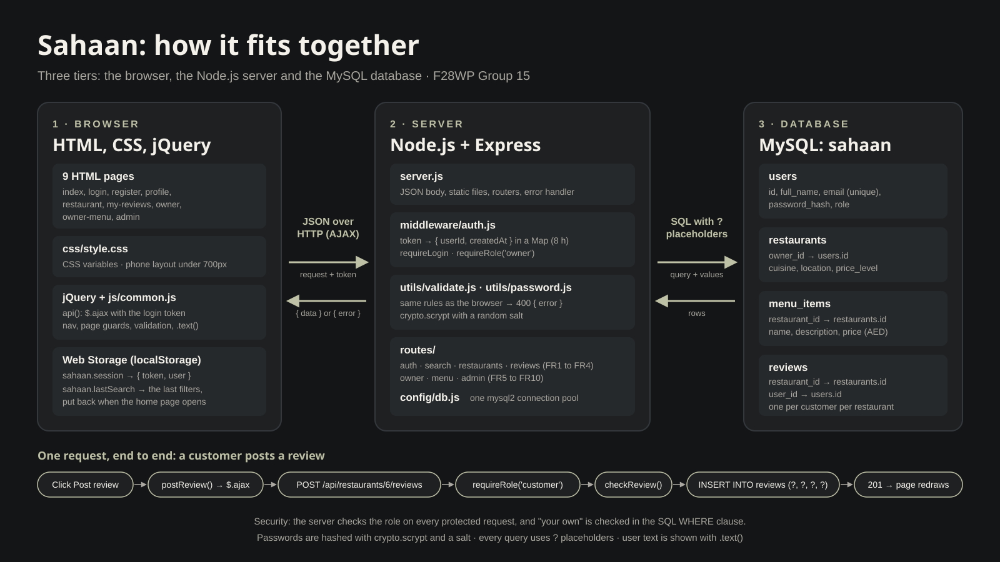

<!-- Owner: Yasin Shafiei. What it is: how Sahaan's parts fit together, one request traced end to end, the API, the tables and the security measures. -->

# Sahaan architecture



## 1. The three tiers

Sahaan is a classic **three-tier web app**:

| Tier | What it is | Files |
|---|---|---|
| **1. Browser** | Plain HTML pages, one CSS file, jQuery. Each page asks the server for data with AJAX and draws it. Web Storage (localStorage) keeps the login and the last search. | `public/` |
| **2. Server** | Node.js with Express. It checks who you are and what role you have, validates the input, runs SQL and answers with JSON. | `server.js`, `routes/`, `middleware/`, `utils/`, `config/` |
| **3. Database** | MySQL with four tables: `users`, `restaurants`, `menu_items`, `reviews`. | `database/` |

They talk like this:

```
Browser  ──  JSON over HTTP (jQuery $.ajax, "Authorization: Bearer <token>")  ──▶  Express
Browser  ◀──  { ...data... }  or  { "error": "message" } with a status code   ──  Express
Express  ──  SQL with ? placeholders (mysql2 pool in config/db.js)            ──▶  MySQL
Express  ◀──  rows                                                            ──  MySQL
```

The pages themselves are static files. The server never builds HTML; it only sends JSON. Every page loads jQuery (from `node_modules`, served at `/vendor/jquery/`), then `js/common.js`, then its own script. `common.js` draws the same header and navigation on every page from the role saved in localStorage.

## 2. One request, traced end to end: a customer posts a review

1. **Click.** customer1 is on `restaurant.html?id=6`, picks 4 stars, types a comment and clicks **Post review**.
2. **Browser check.** `postReview()` in `public/js/restaurant.js` calls `readReviewForm()`, which runs `checkRating()` and `checkComment()` from `common.js`. If either fails, `showFieldErrors()` writes the message under the field and nothing is sent.
3. **AJAX.** `api('POST', '/api/restaurants/6/reviews', { rating: 4, comment: '...' })` in `common.js` calls `$.ajax` with the JSON body and the header `Authorization: Bearer <token>` from localStorage `sahaan.session`.
4. **Express.** `server.js` has already parsed the JSON with `express.json()`. The request reaches `routes/reviews.js`:
   ```js
   router.post('/restaurants/:id/reviews', requireRole('customer'), async (req, res) => { ... })
   ```
5. **Who are you?** `requireRole('customer')` runs `requireLogin` first (`middleware/auth.js`): it finds the token in the `sessions` Map, checks it is less than 8 hours old, and loads the user with `SELECT id, full_name, email, role FROM users WHERE id = ?`. No token gives **401**; a role other than customer gives **403**.
6. **Server check.** `validate.toId(req.params.id)` and `validate.checkReview(req.body)` (`utils/validate.js`) apply the same rules as the browser. Bad input gives **400** `{ "error": "Comment must be 5 to 500 characters." }`.
7. **SQL.** The route checks the restaurant exists (`SELECT id FROM restaurants WHERE id = ?`, else **404**), checks for an earlier review (`SELECT id FROM reviews WHERE restaurant_id = ? AND user_id = ?`, else **409**), then:
   ```sql
   INSERT INTO reviews (restaurant_id, user_id, rating, comment) VALUES (?, ?, ?, ?)
   ```
   `db.query()` in `config/db.js` sends the SQL and the values separately (`pool.execute`), so the comment can never change the SQL.
8. **Answer.** The server replies **201** `{ "message": "Thank you! Your review has been posted.", "id": 24 }`.
9. **Page update.** `.done()` shows the message with `showMessage()` and calls `loadRestaurant()`, which fetches `GET /api/restaurants/6` again. The new average rating, the review list (with the "You" tag) and the "Your review" box with Edit and Delete appear. Every piece of text goes in with jQuery `.text()`, so HTML in a comment shows as plain text.

## 3. The API

All requests and answers are JSON. Errors are `{ "error": "..." }` with:
**400** bad input · **401** not logged in · **403** wrong role · **404** not found, or not yours · **409** duplicate.
Unknown `/api` routes return 404 in the same format; any unexpected error is logged in the terminal and returns **500** `{ "error": "Something went wrong" }`.

"Own" means the server checks ownership inside the SQL `WHERE` clause.

| Method and path | Who | Does | Owner |
|---|---|---|---|
| POST `/api/auth/register` | public | Creates a customer or owner account (never admin), logs in, returns `{ token, user }` | Yasin |
| POST `/api/auth/login` | public | Returns `{ token, user }`. Wrong email or password gets one message | Yasin |
| POST `/api/auth/logout` | logged in | Deletes the token | Yasin |
| GET `/api/auth/me` | logged in | The current user | Yasin |
| PUT `/api/auth/profile` | logged in | Updates name and email; a taken email gets 409 | Yasin |
| PUT `/api/auth/password` | logged in | Changes the password; needs the current one | Yasin |
| GET `/api/restaurants` | public | Search: `q`, `cuisine`, `location`, `price`, `minRating`, `sort` (rating, name, newest) | Yasin |
| GET `/api/restaurants/filters` | public | `{ cuisines, locations, priceLabels }` from `config/lists.js` | Yasin |
| GET `/api/restaurants/:id` | public | The restaurant, its menu and its reviews | Danish |
| POST `/api/restaurants/:id/reviews` | customer | Adds a review; a second one gets 409 | Danish |
| PUT `/api/reviews/:id` | customer, own | Edits a review | Danish |
| DELETE `/api/reviews/:id` | customer, own | Deletes a review | Danish |
| GET `/api/reviews/mine` | customer | My reviews with restaurant names | Danish |
| GET `/api/owner/restaurants` | owner | My restaurants with average rating, review count and menu item count | Orit |
| POST `/api/owner/restaurants` | owner | Adds a restaurant | Orit |
| PUT `/api/owner/restaurants/:id` | owner, own | Updates a restaurant | Orit |
| GET / POST `/api/owner/restaurants/:id/menu` | owner, own | Lists or adds menu items | Aberham |
| PUT / DELETE `/api/owner/menu/:itemId` | owner, own | Updates or deletes a menu item (checked through its restaurant's owner) | Aberham |
| GET `/api/owner/restaurants/:id/reviews` | owner, own | The reviews of one of my restaurants | Aberham |
| GET `/api/admin/stats` | admin | Counts of customers, owners, restaurants and reviews | Yassin |
| GET `/api/admin/users` | admin | Users, filtered by `q` (name or email) and `role` | Yassin |
| PUT `/api/admin/users/:id` | admin | Edits name, email and role; an admin cannot change their own role | Yassin |
| DELETE `/api/admin/users/:id` | admin | Deletes a user; an admin cannot delete themselves | Yassin |
| GET `/api/admin/restaurants` | admin | All restaurants, filtered by `q` | Yassin |
| PUT / DELETE `/api/admin/restaurants/:id` | admin | Edits or deletes any restaurant | Yassin |
| GET `/api/admin/reviews` | admin | All reviews, newest first, filtered by `q` | Yassin |
| DELETE `/api/admin/reviews/:id` | admin | Removes a review | Yassin |

`server.js` mounts `routes/search.js` **before** `routes/restaurants.js`, so `/api/restaurants/filters` is not read as `/api/restaurants/:id` with id "filters".

## 4. The database

Four InnoDB tables in the `sahaan` database, all utf8mb4 (so "Café" and "Künefe" work). The full SQL is in `database/schema.sql`.

```
users        1 ──< many  restaurants   (restaurants.owner_id    → users.id)
restaurants  1 ──< many  menu_items    (menu_items.restaurant_id → restaurants.id)
restaurants  1 ──< many  reviews       (reviews.restaurant_id    → restaurants.id)
users        1 ──< many  reviews       (reviews.user_id          → users.id)
```

| Table | Columns |
|---|---|
| `users` | `id` (PK), `full_name`, `email` (UNIQUE), `password_hash`, `role` ('customer', 'owner', 'admin'), `created_at` |
| `restaurants` | `id` (PK), `owner_id` (FK), `name`, `cuisine`, `location`, `price_level` (1 to 4), `description`, `opening_hours`, `created_at` |
| `menu_items` | `id` (PK), `restaurant_id` (FK), `name`, `description`, `price` DECIMAL(7,2) in AED, `created_at` |
| `reviews` | `id` (PK), `restaurant_id` (FK), `user_id` (FK), `rating` (1 to 5), `comment`, `created_at`, `updated_at`, UNIQUE (`restaurant_id`, `user_id`) |

- **users → restaurants** (one to many): an owner can have many restaurants. `restaurants.owner_id` points to `users.id`.
- **restaurants → menu_items** (one to many): `menu_items.restaurant_id` points to `restaurants.id`.
- **restaurants ↔ users through reviews** (many to many): a review joins one customer to one restaurant. The `UNIQUE (restaurant_id, user_id)` key allows only one review per customer per restaurant.
- **ON DELETE CASCADE** on every foreign key: deleting an owner deletes their restaurants, which deletes those restaurants' menu items and reviews. Deleting a customer deletes their reviews.
- **Indexes** on `restaurants.cuisine` and `restaurants.location` make the two most common filters fast.
- **CHECK constraints** keep `price_level` 1–4, `rating` 1–5 and `price` 0.50–9999.99 even if someone edits the database by hand.
- **Average ratings** are never stored. They are worked out when needed:
  ```sql
  SELECT r.id, r.name, ROUND(AVG(rv.rating), 1) AS avg_rating, COUNT(rv.id) AS review_count
  FROM restaurants r
  LEFT JOIN reviews rv ON rv.restaurant_id = r.id
  GROUP BY r.id
  HAVING AVG(rv.rating) >= ?
  ```
  `LEFT JOIN` keeps restaurants with no reviews (their average is `NULL`). `HAVING` filters after the averages exist, which `WHERE` cannot do.

## 5. Security

| Measure | Where | How |
|---|---|---|
| Passwords are never stored | `utils/password.js` | `crypto.scryptSync(password, salt, 64)` with a 16-byte random salt, stored as `salt:hash` in hex. Checked with `crypto.timingSafeEqual`. |
| Login tokens | `middleware/auth.js` | `crypto.randomBytes(32)` gives a 64-character random token. The server keeps `token → { userId, createdAt }` in a `Map`. Tokens expire after 8 hours; logout deletes them. |
| Role checked on every protected request | every route file | `requireLogin` or `requireRole('customer' / 'owner' / 'admin')` runs before the route. The user is loaded from the database each time, so a role change or a deleted account takes effect at once. |
| You can only change your own data | `routes/reviews.js`, `owner.js`, `menu.js`, `auth.js` | Ownership is part of the SQL, e.g. `UPDATE reviews ... WHERE id = ? AND user_id = ?`. 0 rows changed gives 404, so nobody can even tell whether someone else's item exists. |
| No admin sign-ups | `utils/validate.js` | Register only accepts `customer` or `owner`. |
| Admins cannot lock themselves out | `routes/admin.js` | An admin cannot change their own role or delete their own account. |
| SQL injection | `config/db.js` and every route | Every value goes through a `?` placeholder. `ORDER BY` cannot use `?`, so the browser sends a short name (`rating`, `name`, `newest`) and the server picks the SQL from a fixed list. A search for `' OR 1=1 --` just finds nothing. |
| Cross-site scripting (XSS) | every page script | User text goes on the page with jQuery `.text()` (or `escapeHtml()`), never `.html()`. A review containing `<script>` is shown as plain text. |
| Validation twice | `public/js/common.js` and `utils/validate.js` | The same rules and messages in the browser (for quick feedback) and on the server (because the browser can be bypassed). The server answers bad input with 400. |
| Safe redirects | `public/js/login.js` | After login, `?next=` is only followed if it is one of our own pages. |
| One generic login error | `routes/auth.js` | Wrong email and wrong password both get "Wrong email or password." |
| No secrets in the code | `config/db.local.json` | The MySQL password lives only in this git-ignored file. |
| Page guards are only for tidiness | `public/js/common.js` | `requireRole(['owner'])` hides pages from the wrong users, but the server still checks every request itself. |
